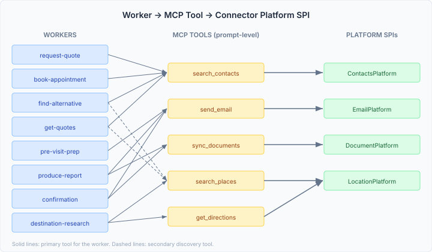

# Four connectors, 92 operations, and the case for mechanical pre-staging

casehub-life has had platform connector SPIs sitting unused since the skill
integration work in Layer 7. ContactsPlatform, EmailPlatform, DocumentPlatform,
LocationPlatform — each with production implementations (Google Contacts,
Gmail, Google Drive, Google Maps) — but no workers actually calling them.
The workers referenced `send_chat` and `calendar_create_event` and stopped
there.

I wanted to see how fast the remaining connectors could be wired in, given
the architecture we'd built. The answer: four in a single session, touching
18 workers across 6 CaseHubs. But the wiring itself turned out to be less
interesting than what it revealed about the platform's API surface — and
what that surface makes possible.

## The wiring pattern

Every connector wiring follows the same three-step change:

1. **System prompt** — add the MCP tool name and a usage instruction to
   the worker's prompt string. "Use search_contacts to look up the
   contractor's contact details."

2. **Response schema** — add a nullable ID field to the worker's result
   record. `String contactId`, `String emailMessageId`, `String documentId`,
   `String placeId` — following the existing `calendarEventId` and
   `notificationMessageId` convention.

3. **Test factory** — update the canned JSON response to include the new
   field and the tool name in `toolsUsed`.

No Maven dependencies. No CDI beans. No new services. The MCP tool bridge
means the worker's system prompt is the entire integration surface.

| Issue | Connector | Tool references | Workers |
|-------|-----------|----------------|---------|
| #131 | ContactsPlatform | `search_contacts`, `list_contacts` | 7 — request-quote, job-monitoring, book-appointment, find-alternative, needs-assessment, care-plan, get-quotes |
| #132 | EmailPlatform | `send_email` | 4 — pre-visit-prep, produce-report, confirmation, record-completion |
| #133 | DocumentPlatform | `sync_documents` | 4 — produce-report, care-plan, confirmation, record-completion |
| #134 | LocationPlatform | `search_places`, `get_directions` | 3 — destination-research, find-alternative, get-quotes |

Some workers now stack multiple connector tools. The `confirmation` worker
in TravelPlanCaseHub references `calendar_create_event`, `sync_documents`,
`send_email`, and `send_chat` — four platform SPIs in a single worker
prompt. The agent decides which to use based on the content: formal
itineraries go to email and document storage, quick confirmations go to chat.

## 92 operations across 11 domains

After the wiring, I audited the full GraphQL surface. Every connector SPI
has a `@McpDomain`-annotated GraphQL API — 11 domains, 92 operations total.

| Connector | Ops | Key operations |
|-----------|-----|----------------|
| Bank | 6 | listAccounts, balance, listTransactions, initiatePayment |
| Calendar | 7 | listEvents, createEvent, updateEvent, syncEvents |
| Chat | 12 | sendChat, listChannels, messageHistory, replyToMessage |
| Commerce | 11 | searchProducts, addToCart, checkout, listOrders |
| Contacts | 9 | searchContacts, getContact, createContact, listGroups |
| Document | 10 | uploadFile, searchDocuments, getShareLink, listFolders |
| Email | 4 | listMessages, getMessage (send goes through Messaging) |
| Location | 7 | searchPlaces, searchNearby, geocode, directions |
| Messaging | 5 | sendSms, sendWhatsApp, sendEmail, sendSlack, sendTeams |
| Project | 18 | listIssues, createIssue, searchIssues, listComments |
| Travel | 12 | searchTransport, bookTransport, searchAccommodation |

The Document API was the one gap — only `syncDocuments` was exposed when
the full SPI has file, folder, search, and sharing operations. That's been
expanded now (connectors#174).

This isn't just a wiring inventory. It's the surface area that playbooks
can batch over.

## Two paths to the same connectors

The MCP tool calls are the direct path — one agent, one tool invocation,
one result. But the same operations are exposed over GraphQL through those
`@McpDomain` APIs. That means playbooks can batch the same operations
that workers call individually.

A worker calling `search_contacts` is making a single lookup mid-task.
A playbook can compose `searchContacts` + `getContact` + `createContact`
into a batch sequence over GraphQL — sync a contractor's details from
Google Contacts, check if they exist locally, create them if not — without
an LLM in the loop. Same SPI, same operations, different execution model.

## Why this matters: mechanical pre-staging

This matters most for project-oriented work — the kind where a case spans
multiple domains and needs coordination across them. A home renovation
touches contractors (ContactsPlatform), scheduling (CalendarPlatform),
documents (DocumentPlatform for invoices and permits), location
(LocationPlatform for site details), and finance (BankPlatform for
payments). A naive approach gives each worker its own MCP calls and lets
the LLM figure out the coordination. But a lot of that coordination is
mechanical.

The execution model I think we need has three layers:

**The LLM plans the coordination once.** It assesses the incoming request
and selects which playbooks to use — or generates a new one if nothing
matches. It maps which cases to start, what context they need, and what
post-processing should happen after workers finish. This is the judgment
call: what does this situation need?

**Playbooks execute mechanically.** Pull contractor details, fetch
invoices from document storage, check calendar for conflicts, geocode
the site address — all batched over GraphQL, no LLM tokens burned.
Scripts combine and index the results into a structured context package.
When the LLM finally gets involved as a worker, it gets a pre-assembled
view of the situation and focuses on reasoning — is this quote reasonable
given the contractor's history, should we escalate the timeline.

**Post-processing runs mechanically too.** After workers produce decisions:
store reports via DocumentPlatform, send notifications via Email and Chat,
update the calendar, record ledger entries, feed outcomes to CBR. All
configured by the LLM in the planning phase, executed without it.

The Serverless Workflow runtime that just landed in the platform
(platform#661) gives playbooks an execution model. The 92 GraphQL
operations give them something to execute against. The connector SPIs
being accessible through both paths — direct MCP for in-flight agent
decisions, GraphQL batches for orchestrated pre-staging — is what makes
this work without duplicating the integration.

The key insight: playbooks should be reusable. The LLM generates a
"contractor onboarding" playbook once — search contacts, check trust
score, geocode address, pull recent invoices — and it becomes available
for future cases. CBR informs which playbooks worked well for similar
situations. Over time the system builds a library of mechanical
coordination patterns, and the LLM's planning job gets easier because
the playbooks it needs already exist.

## Why prompt-level, not compile-time

When we built the skill integration in Layer 7, the choice was between
compile-time dependency on each connector SPI or prompt-level tool
references. We went with prompt-level. The workers don't know what a
`ContactsPlatform` is. They know that `search_contacts` exists and
returns contact details. The MCP domain bridge handles the mapping.

The trade-off: no compile-time validation of connector interactions. If
`search_contacts` changes its response shape, the agent's structured
output schema is the contract, and mismatches surface at runtime. For
stable platform SPIs, that's acceptable. For frequently changing APIs,
it wouldn't be.

## What's next

The wiring sprint is done. What remains is genuine feature work:

**#140 — Playbook mechanical coordination.** The design session for the
three-layer model described above. Platform#661 (Serverless Workflow
runtime) and connectors#174 (Document API expansion) have both landed,
so the foundation is ready.

**#135 — CommercePlatform.** Breaks the wiring pattern — needs new case
definitions for procurement and household supply reordering. Design
session, not a prompt edit.

**#136 — BankPlatform PISP.** Payment initiation through open banking.
Consequential action that needs the oversight gate and risk
classification involved. Not a prompt edit either.

The easy wins surfaced a harder question: how should the platform
coordinate mechanical work across connectors so the LLM can focus on
what it's actually good at? That's #140.
