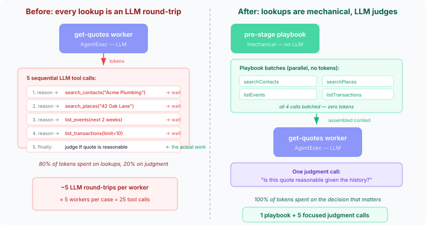
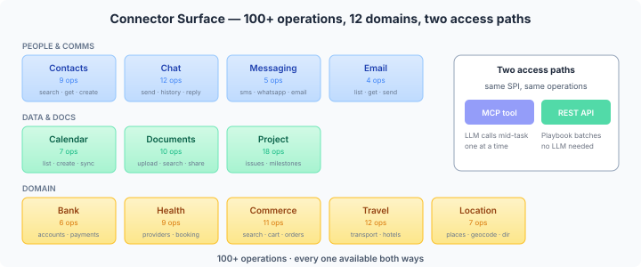
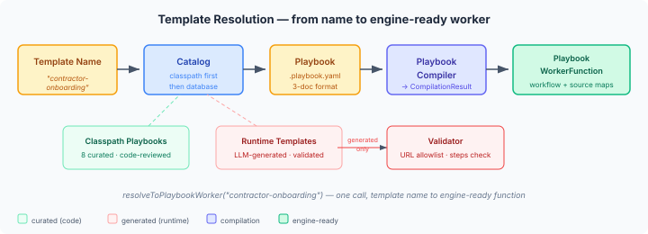
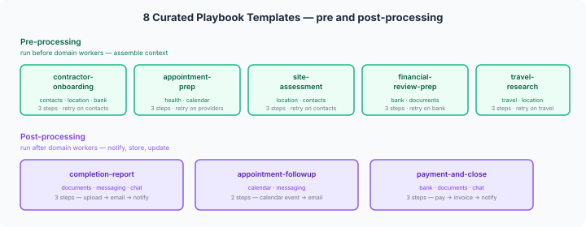

# Why your LLM workers shouldn't be making phone calls

A home renovation case touches contractors, calendars, documents,
locations, and finance. In casehub-life, each of those domains has an
LLM-backed worker — an agent with a system prompt, a response schema,
and access to connector platform tools via MCP. The worker calls
`search_contacts` to find the contractor, `search_places` to geocode
the site, `list_transactions` to pull payment history. Each call is a
round-trip through the LLM: the model reasons about what to look up,
formulates the tool call, waits for the result, processes it, and
moves on.

Every one of those lookups is mechanical. The LLM isn't making a
judgment call when it searches for "Acme Plumbing" in the contacts
database. It's doing clerical work at the price of reasoning.

## The connector surface

After wiring four connector SPIs last week — ContactsPlatform,
EmailPlatform, DocumentPlatform, LocationPlatform — casehub-life
has access to over 100 GraphQL operations across 12 connector
domains. HealthPlatform, TravelPlatform, and CommercePlatform landed
the same week. Every operation is exposed two ways: as an MCP tool
(for LLM workers to call mid-task) and as a REST endpoint via
`@McpDomain` annotations (for programmatic access).

The dual-path architecture means the same operations are available
for both paths. An LLM worker calling `search_contacts` mid-task is
making a single lookup. A playbook calling `/api/connectors/contacts/searchContacts`
over REST is doing the same thing — without an LLM in the loop.

## The execution model

The idea is straightforward. An LLM should plan the coordination, not
execute it. The judgment call is "what does this situation need?" — which
playbooks to run, which connectors to hit, what post-processing to do
after workers finish. The mechanical work — actually calling the APIs,
batching the results, combining them into a context package — that's
deterministic. No tokens required.

Four phases, two of which are LLM-free:

**Phase 1 — Planning.** A coordination worker (AgentExec) assesses the
incoming request, selects pre-processing and post-processing playbooks
from a catalog, and writes a `CoordinationPlan` to the case context.
This is the one LLM call that earns its tokens — it's making decisions
about what this specific case needs.

**Phase 2 — Pre-processing.** A playbook runs: search contacts, geocode
the site, pull recent transactions, check calendar availability. All
`rest-request:` steps, executed mechanically. The domain worker receives
a pre-assembled context package and can focus on judgment — "is this
quote reasonable given the contractor's trust score?" instead of "let me
look up the contractor first."

**Phase 3 — Domain workers.** The existing AgentExec workers, unchanged.
They still have MCP tool access for in-flight decisions the playbook
couldn't anticipate. But the routine lookups are already done.

**Phase 4 — Post-processing.** Another playbook: store the completion
report in DocumentPlatform, email a summary, send a chat notification,
update the calendar. Sequenced, mechanical, no LLM needed.

## Why playbooks, not raw Serverless Workflow

This is where the design session got interesting.

I started with what seemed obvious: define the mechanical work as
Serverless Workflow `do:` blocks and execute them through the existing
`FlowWorkerFunction`. The platform already had the CNCF SWF SDK-Java
wired up. Build a dispatcher to route `call:` steps to connector
APIs, add some plumbing to the engine — done.

Three problems surfaced during the design review. `PlanItemDefinition`
was sealed. `CallableDispatchRegistry` did exact-match lookup only.
`CasehubFlowContext.callableRegistry()` was package-private. Every
assumption required breaking an API boundary in a cross-repo
dependency. The review pushed toward raw SWF as the solution, which
would have meant writing deeply nested YAML for what should be a
few lines of coordination logic.

The answer had been in the platform all along. CaseHub has a playbook
language — built during the SC2 build-order work, extended through
platform #562 and #563. `PlaybookCompiler` compiles playbook YAML into
the same SWF `Workflow` objects that the SDK-Java executes. Same
engine, better language.

Ignoring metadata preamble on both sides, the step definitions tell
the story. `retry: 3` is an inline decorator — one line. In SWF, the
same retry requires a `try:` wrapper, a `catch:` block, a `retry:`
object, a `limit:` object, and an `attempt:` object with a `count:`
field. Seven lines of nesting for one concept. `parallel:` for
concurrent operations vs `fork → branches → do`. `signal:` and
`await:` for coordination primitives that have no concise SWF
equivalent. The playbook language is strictly more expressive — the
compilation is additive, never lossy.

And the architectural payoff: no engine changes at all. Playbooks use
`rest-request:` steps for connector calls — direct HTTP to the REST
endpoints. `PlaybookCompiler` compiles them, `PlaybookWorkerFunction` wraps
the result, `FlowWorkerFunctionHandler` executes it. Zero new platform
SPIs, zero cross-repo modifications.

## Playbook-first, universally

SWF 1.0 is a good execution engine. CaseHub uses it — under the hood,
invisible. But as an authoring format for domain coordination, it's the
wrong level of abstraction. You don't want to write `TryTask` with
`RetryPolicy` when you mean `retry: 3`.

The playbook language exists because build-order coordination, event
sequencing, and multi-step orchestration all need the same primitives:
parallel execution, conditional branching, retry with backoff, timeout,
signals, barriers. The SC2 work needed them. IoT monitoring needs them.
AML investigation workflows need them. And now connector coordination
in casehub-life needs them.

If interop matters, `PlaybookCompiler` can emit SWF YAML as an export
format. The types are the same. But the authoring direction is settled:
playbooks everywhere, SWF underneath.

## When playbooks fail

The hardest problem isn't playbook generation — it's what happens when
a generated playbook doesn't work. A connector times out. The contacts
API returns nothing for a contractor who isn't in the system yet. The
health provider's booking endpoint expects a different parameter shape
than the playbook assumed. The playbook runs, produces partial or empty
results, and the domain worker receives an incomplete context package.
Worst case: silent failure. The case sits there. Nobody gets notified.
Nothing happens.

This is where the LLM earns its keep a second time. On playbook failure
or partial failure, the planning worker gets re-invoked with the failure
context. It triages: retry with different parameters? Select a different
playbook? Fall back to letting the domain worker do the lookups via MCP
tools the old way? The triage is a judgment call — exactly the kind of
reasoning we're trying to preserve by moving the mechanical work out.

CBR closes the loop. A failed playbook feeds into retention with a
negative outcome. Next time similar features appear — same contractor,
same provider type, same domain — the planning worker sees "last time
the standard playbook failed here, the adapted version added a
pre-check step." Different interaction points may need different
playbooks even for the same case type. A contractor who's in the
contacts database gets the standard onboarding playbook. One who isn't
gets a playbook that creates the contact first.

The cap is two triage attempts per case start. After that, fall back
to MCP tools — the domain workers still have their tool access, the
old way still works. Mechanical coordination is an optimisation, not
a gate. If playbooks can't handle it, the LLM does it directly. No
silent failure, no infinite retry loops (#141).

## What's landed

The foundation batch is committed. 21 files, 15 tests.

`CoordinationPlan` is the planning worker's output — which pre-processing
playbook, which post-processing playbook, which domain workers to skip,
which to parameterise. It's a record in the `api/` module, zero framework
dependencies, round-trips cleanly through JSON.

`CoordinationTemplateCatalog` is the playbook library. It loads 8 curated
`.playbook.yaml` files from the classpath at startup and merges them with
LLM-generated templates stored in a database table (`V114` migration).
The key method is `resolveToPlaybookWorker()` — it takes a template name,
compiles the playbook YAML via `PlaybookCompiler`, and returns a
`PlaybookWorkerFunction` ready to wire into a case definition.

The catalog parses the 3-document YAML format (front matter, metadata,
steps) using SnakeYAML directly, extracting `meta.domain` and
`meta.description` for catalog queries. I avoided pulling in
`yaml-step-runtime` as a dependency — the multi-document YAML parsing
is 20 lines of SnakeYAML, not worth a transitive dependency for.

`CoordinationTemplateValidator` enforces security on LLM-generated
templates. Every `rest-request:` URL must start with `/api/connectors/`
— no external HTTP calls, no non-connector local paths. The playbook
must have a `steps:` block and must compile successfully. A generated
playbook that fails validation falls back to MCP tool calls — the
domain workers still have their tool access.

## What surfaced during implementation

**`PlaybookWorkerFunction` landed in the engine** (engine#1263). This is
the playbook counterpart to `FlowWorkerFunction` — wraps a compiled
`Workflow` plus the full `CompilationResult` (source maps, coordination
specs). `FlowWorkerFunctionHandler` executes both via a shared
`SWFWorkerFunction` sealed interface. The catalog returns
`PlaybookWorkerFunction` directly — one call from template name to
engine-ready worker function.

**Expression variables in URLs break `RestRequestCompiler`.**
`URI.create()` chokes on `${input.contractorName}` in query strings.
The expressions are runtime SWF constructs, not compile-time literals,
but the compiler validates the URI at compile time. Filed platform#675.
For now, the templates use POST with body parameters instead of GET with
query strings. Once the compiler handles URI templates, the playbooks
can use the more natural GET-with-params style.

**SWF version convergence.** The engine SNAPSHOT (rebuilt with
`playbook-compiler` dependency) pulls in SWF SDK 7.35.3.Final, while
`quarkus-flow` brings 7.25.1.Final. Maven's enforcer catches the
mismatch. Fixed with `dependencyManagement` overrides in life's parent
pom — force convergence to the newer version. Not a runtime issue
(newer is compatible), just an enforcer policy.

## What shipped

Both batches landed in a single squashed commit. 25 files, 1054 lines,
19 tests.

`buildFreshDefinition()` on `LifeTypedCaseHub` takes a base
`CaseDefinition` and a `CoordinationPlan`, copies the domain workers
into a fresh definition via the Builder, then inserts
`PlaybookWorkerFunction` workers at the front (pre-processing) and back
(post-processing). Workers listed in `skipWorkers` get removed. Generated
templates pass through the validator before compilation. The base
definition is never modified — the cached singleton stays intact.

`LifeCaseService.startCase()` gained two new phases between CBR
retrieval and engine start. Phase 3 invokes the planning worker via
`WorkerAgentInvoker.execute()` — a synchronous LLM call that returns
a `CoordinationPlan`. Phase 4 calls `buildFreshDefinition()` with the
plan. Phase 5 starts the engine with the fresh definition. If the
planning worker fails, the service falls back to the base definition.
No coordination, no error — the domain workers still have their MCP
tools.

The follow-up issues are open: playbook failure triage (#141),
generic platform failure handling (platform#668), and the
`RestRequestCompiler` URI template fix (platform#675). None are
blockers — the foundation works now, and the system degrades
gracefully when playbooks fail.
