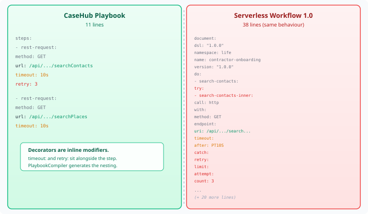
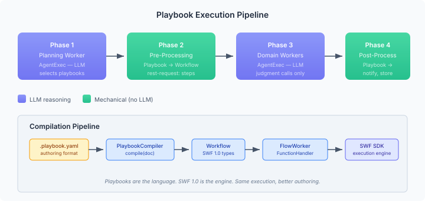

# Playbooks over Serverless Workflow: why CaseHub's language wins

Yesterday I wired four connector SPIs into 18 workers and documented
the 92 GraphQL operations across 11 domains. The question that came out
of that sprint was obvious: how do we batch those operations so the LLM
stops burning tokens on mechanical lookups?

The answer turned out to be simpler than expected — and it required
walking into a wall first.

## The wrong wall

I started the design session for #140 with what seemed like a reasonable
architecture: define mechanical coordination as Serverless Workflow
`do:` blocks, execute them via `FlowWorkerFunction`. The platform
already had the SWF SDK-Java wired up, `FlowWorkerFunctionProvider`
handled `do:` blocks from YAML, and `CasehubCallableTaskBuilder` routed
`call:` steps to dispatchers. Build a `ConnectorCallableDispatcher` to
bridge `call: casehub:connector/*` to the connector REST APIs, add
prefix matching to `CallableDispatchRegistry`, inject the call name into
the args map — three engine changes, a new dispatcher, a new routing
layer.

The decision review caught it. Claude flagged that the "platform
playbook runtime" I was referencing didn't exist as described — the
platform's playbook infrastructure was actually the pages/aria content
system, not a connector-batching engine. The decision reviewer
verified via code navigation that `PlanItemDefinition` was sealed,
`CallableDispatchRegistry` did exact-match lookup only, and
`CasehubFlowContext.callableRegistry()` was package-private. Every
assumption in the original design required breaking an API boundary.

The review was right about the problems. But it pointed toward raw SWF
as the solution, and that was the wrong direction too.

## The right direction was already there

CaseHub has a playbook language. It's been in the platform since the
SC2 build-order work — `parallel:`, `concurrent:`, `race:`, `forEach:`,
`signal:`, `await:`, decorators for `timeout`, `retry`, `when`, `mutex`.
And `PlaybookCompiler` compiles all of it down to the same SWF `Workflow`
objects that the SDK-Java executes.

The playbook language is strictly more expressive than raw SWF YAML.
Everything SWF can express, a playbook can express — the compilation
is additive, never lossy. But the reverse isn't true: playbook
coordination primitives (barriers, signals, semaphores in the
`orchestration:` block), structural decorators, and the concise step
syntax have no SWF equivalent without verbose nesting.

Here's what a contractor onboarding coordination looks like in both
formats. Same behaviour. Same compiled output.

The playbook is 11 lines. The SWF equivalent is 38. And the gap widens
with composition — add `parallel:` for concurrent connector calls and
it's 4 lines vs 17. Add `retry: 3` as an inline decorator vs the nested
`TryTask → RetryPolicy → RetryLimit → RetryLimitAttempt` structure. The
playbook language absorbs the ceremony that SWF requires.

## What this means for #140

The architecture simplified dramatically once I stopped thinking in SWF
and started thinking in playbooks.

Coordination templates are `.playbook.yaml` files. The planning worker
(an AgentExec that runs pre-engine) selects or generates them. They use
`rest-request:` steps for connector calls — direct HTTP to the connector
REST endpoints, no custom dispatcher needed. `PlaybookCompiler` compiles
them to `Workflow` objects, `FlowWorkerFunction` wraps them, and
`FlowWorkerFunctionHandler` executes them via the SWF SDK.

No engine changes. No `ConnectorCallableDispatcher`. No prefix matching
on `CallableDispatchRegistry`. No `_callName` injection. The entire
Batch 1 of the original implementation plan — three engine modifications
in a cross-repo dependency — dropped to zero.

What remains is domain work in casehub-life:

- A `CoordinationTemplateCatalog` that merges curated classpath playbooks
  with LLM-generated runtime playbooks
- A `CoordinationTemplateValidator` that enforces URL allowlists on
  generated playbooks
- 8 curated `.playbook.yaml` templates covering contractor onboarding,
  appointment prep, financial review, travel research, and post-processing
  patterns
- `buildFreshDefinition()` on `LifeTypedCaseHub` that wires
  `FlowWorkerFunction` workers from compiled playbooks into per-case
  definitions
- An extended 5-phase `LifeCaseService.startCase()` — the existing
  scaffold → CBR retrieval flow gains a planning worker invocation and
  definition build before engine start

## Playbooks as universal format

SWF 1.0 is a fine execution engine. CaseHub uses it — `PlaybookCompiler`
targets SWF types, `FlowWorkerFunctionHandler` runs SWF
`WorkflowApplication`. The standard is doing its job under the hood.

But as an authoring format, SWF YAML is verbose, structural, and
hostile to the kind of declarative coordination that CaseHub domains
need. A `rest-request:` with `retry: 3` and `timeout: 10s` is how
you want to express "call this endpoint, retry three times, give up
after ten seconds." Not five levels of nested YAML objects.

CaseHub playbooks compile to SWF. If interop ever matters,
`PlaybookCompiler` can emit SWF YAML as an export. The reverse doesn't
work — SWF can't express playbook coordination primitives without the
verbose structure that the playbook language was designed to eliminate.

The direction is clear: playbooks everywhere, SWF under the hood. The
connector coordination work in #140 is the first domain application of
this, but the pattern applies universally across CaseHub.

## What's next

The implementation plan is two batches. First: the coordination types,
catalog, validator, and 8 curated playbook templates. Second: the case
integration — `buildFreshDefinition()`, planning worker, and the
extended case start. No cross-repo changes. The platform already has
everything we need.

The design doc and plan are at
`specs/issue-140-playbook-coordination/2026-10-27-playbook-coordination-design.md`
and `plans/2026-10-27-playbook-coordination.md` in the workspace.
