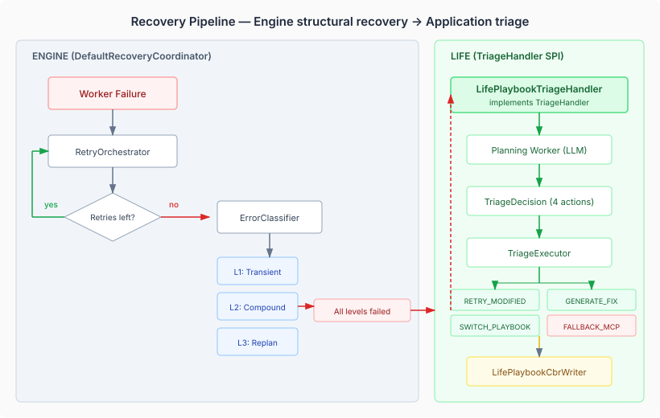
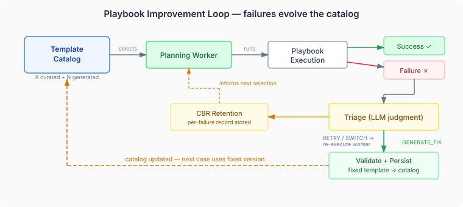

# When playbooks break: failure recovery for LLM-orchestrated workflows

An LLM-generated playbook that fails silently is worse than no playbook at all. Without one, the domain worker makes its own connector calls — slower, more expensive, but functional. With a broken playbook, the worker receives partial data and makes decisions on incomplete context. Or receives nothing and sits idle. The case stalls. No error. No feedback. The same broken playbook gets selected next time.

This is the gap that casehub-life's playbook failure recovery addresses. Not by preventing failures — connector timeouts, parameter mismatches, and endpoint changes are inevitable — but by detecting them, triaging them with LLM judgment, and feeding the outcomes back into the system so it learns.

## 1. The Problem: Three Failure Modes

Playbooks are compiled Serverless Workflow definitions that execute mechanical coordination steps — fetching contacts from a CRM, geocoding an address, pulling payment history from a banking API. Each step is a REST call to a local connector endpoint. Three things can go wrong.

**Total failure** is the easy case. A connector throws, the workflow engine catches it, the `RetryOrchestrator` retries per the retry policy. When retries exhaust, the engine fires `WorkerRetriesExhaustedEvent`. Visible, traceable, actionable.

**Partial failure** is insidious. A playbook with five connector steps succeeds on three and fails on two. The workflow completes without throwing. The engine produces `PlaybookExecutionResult.Success`. The domain worker receives a result that looks valid — it has data — but the data is incomplete. A home renovation case might get the contractor's contact details but miss the payment history. The worker proceeds on partial information and makes a worse decision. Nobody knows.

**Planning failure** is structural. The planning worker itself — the LLM that selects which playbook template to use for a given case — throws an exception. The current code catches it, logs a warning, and falls through to uncoordinated execution. The case proceeds as if playbooks don't exist. No record of what went wrong.

## 2. Why the Obvious Extension Point Is Wrong

The engine exposes `RecoveryCoordinator` — a single-method SPI that gets called when a worker exhausts all retry attempts. Life implements it, intercepts playbook failures, re-invokes the planning worker to triage. Clean boundary. Obvious extension point.

I designed the entire system around this. Six decisions captured in the spec. Four-action triage model. Per-worker round counting. CBR retention for failed playbooks. All anchored on `RecoveryCoordinator`.

Then we read the engine's actual `DefaultRecoveryCoordinator`.

It's not a stub. It's 465 lines of recovery machinery that the engine team built for exactly these scenarios. Three levels of structural recovery:

- **Level 1 — Transient.** The error classifier says this failure is temporary. The agent stays eligible. The engine retries without changing anything.
- **Level 2 — Compound adaptation.** The failing worker is part of a compound (a group of related plan items). The engine locally patches the compound — excludes the failed agent, re-evaluates the compound's internal bindings, and lets the adapted compound re-execute.
- **Level 3 — Full replan.** The entire goal decomposition re-runs. Pending plan items are marked obsolete. The engine rebuilds the execution plan from scratch with current state.

After all three levels have been attempted (or skipped per the recovery policy), the engine calls `TriageHandler.evaluate()` — a platform SPI for application-level triage decisions.

Implementing `RecoveryCoordinator` as an `@Alternative` would displace all of this. The error classification, the compound adaptation, the full replan — gone. Replaced by playbook-specific triage that doesn't understand the engine's structural recovery capabilities.

`TriageHandler` is the correct extension point. Life implements `TriageHandler`, the engine does its structural recovery first, and only when that isn't enough does the application get to make a judgment call.

**The principle is general:** when an engine provides a recovery pipeline, extend at the end of the pipeline, not at the beginning. The engine's structural recovery handles failures your application code doesn't understand — network transients, resource contention, stale bindings. Your application handles failures the engine can't — domain-specific triage that requires judgment about which playbook to try next.

## 3. What the Triage Handler Actually Does

`LifePlaybookTriageHandler` implements the platform `TriageHandler` SPI. The engine calls it with a `TriageContext` carrying the failure summary, per-step results, the attempt number, and the max attempts allowed by the recovery policy.

The handler re-invokes the planning worker — the same LLM that originally selected the playbook — with the failure context. The planner sees which steps failed, what errors occurred, what partial output was produced, and what alternative templates exist in the catalog. It returns a structured `TriageDecision` with one of four actions:

| Action | What happens | When to use |
|--------|-------------|------------|
| `RETRY_MODIFIED` | Same playbook, adjusted parameters | Early attempts — the template is probably right, the params are wrong |
| `SWITCH_PLAYBOOK` | Different template from the catalog | The template is wrong for this context |
| `GENERATE_FIX` | New YAML validated and persisted to catalog | Later attempts — the template itself needs structural changes |
| `FALLBACK_MCP` | Abandon playbooks entirely | No viable playbook — let the domain worker use MCP tools directly |

The handler maps these to the engine's `TriageDecision.Retry(modifications)` or `TriageDecision.Abandon(reason)`. The first three actions map to `Retry` — the engine gives the worker a fresh retry budget. `FALLBACK_MCP` maps to `Abandon` — the engine's normal exhaustion path handles the rest.

This is the LLM earning its tokens. A mechanical system would retry with the same parameters or give up. The planning worker can reason about *why* the step failed and produce a qualitatively different recovery strategy.

## 4. The Improvement Loop: Catalogs That Evolve

The most interesting action is `GENERATE_FIX`. When the planning worker decides the template itself is broken, it produces corrected YAML. The `TriageExecutor` validates the fix through the existing `CoordinationTemplateValidator` — parseable, has steps, compiles successfully, all URLs are local `/api/connectors/*` paths. If validation passes, the fixed template is persisted to the `CoordinationTemplateCatalog`.

Two protection rules apply. First, curated templates — the eight playbooks shipped on the classpath — are never replaced at runtime. A fix for `contractor-onboarding` gets saved as `contractor-onboarding-fixed`. The curated version remains authoritative; the fix is a runtime alternative. Second, generated templates start with a use count of zero. They earn trust through successful executions, not through being produced by an LLM.

Over time, the catalog evolves. The initial eight curated templates handle the common cases. When edge cases fail — a contractor whose CRM uses non-standard field names, a health provider whose appointment API returns a different response shape — the system generates fixes. The fixes accumulate. Similar cases in the future get the fixed version.

This is adaptation at the catalog level, not the case level. A per-case fix helps one execution. A persisted template fix helps every future execution with a similar context.

## 5. CBR: Learning From Every Failure

Each triage decision — whether it succeeds or not — is recorded as a CBR (Case-Based Reasoning) case. `LifePlaybookCbrWriter` observes the `PlaybookTriageEvent` and writes a `CbrPlanRecord` with playbook-specific features:

- **templateName** — which template was involved
- **failedStepCount** — how many steps failed out of the total
- **connectorErrorType** — categorised: timeout, auth, not-found, server-error
- **triageAction** — what recovery was attempted
- **triageRound** — how many triage attempts preceded this one

The next time a similar case starts, the CBR retrieval surfaces these records. The planning worker sees: "Last time with this contractor, the standard playbook failed on the contacts API — the fixed version with a pre-check step worked." The planner can skip directly to the working template instead of repeating the failure.

This is the difference between a system that retries and a system that learns. Retrying is mechanical. Learning requires recording what failed, in what context, with what recovery, and surfacing that record at the point where the next decision is made.

## 6. Practical Architecture: Where Each Piece Lives

The recovery pipeline spans three layers, each with clear ownership:

**Engine layer** owns structural recovery — retry policies, error classification, compound adaptation, replanning. This is generic recovery that works regardless of the application domain. The engine doesn't know what a playbook is. It knows a worker failed, it knows the retry budget, and it knows how to adapt the execution plan.

**Platform layer** owns the extension point — `TriageHandler` is a platform SPI in `io.casehub.platform.api.governance`. The engine calls it; applications implement it. The platform also owns the `TriageContext` and `TriageDecision` types — the contract between engine recovery and application triage.

**Application layer** owns domain judgment — which playbook to try next, whether to generate a fix, when to give up. `LifePlaybookTriageHandler`, `TriageExecutor`, and `LifePlaybookCbrWriter` are all application-layer code in `casehub-life`. They know about playbook templates, coordination catalogs, and life domains. The engine never sees them.

**One piece remains in the engine.** `FlowWorkerFunctionHandler` needs to produce `PlaybookExecutionResult.PartialSuccess` when some steps fail. The type already exists in the engine API — designed for this scenario, never produced. Five lines of code. Without this change, partial failures are invisible to the entire recovery pipeline.

## 7. Why This Matters Beyond CaseHub

The pattern generalises. Any system where LLMs orchestrate mechanical steps has the same failure modes: total failure (visible), partial failure (invisible), and planning failure (structural). The recovery model needs three properties:

**Don't displace structural recovery.** The runtime knows things your application doesn't — network topology, resource pools, execution state. Extend at the end of the recovery pipeline, not at the beginning.

**Make triage a judgment call.** Mechanical retry with the same parameters is the lowest form of recovery. An LLM that can reason about *why* a step failed and produce a qualitatively different strategy earns the inference cost. The four-action model — retry modified, switch, generate fix, fall back — covers the decision space without leaving it open-ended.

**Record every failure.** Not for dashboards. For the next decision point. A system that surfaces "this template failed for this contractor last time" at the moment the next case starts is structurally different from one that just retries and hopes. CBR retention turns every failure into calibration data for future planning.

The systems that will matter are not the ones that never fail. They're the ones that fail, recover, and get better at recovering.
