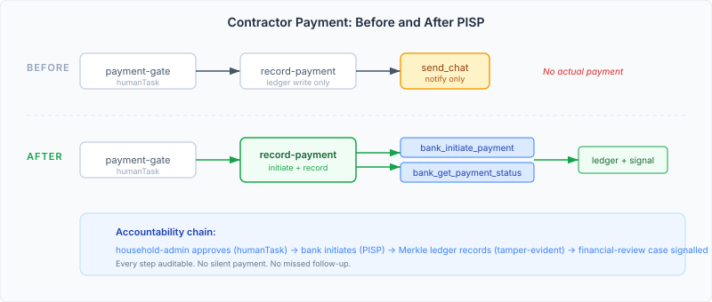
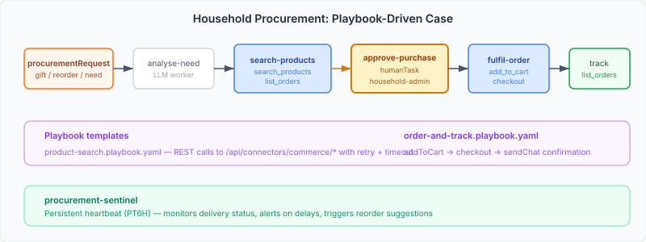

# Accountability Where It Actually Matters

There's a contractor who did a job on my house last year. Good work, fair price, paid by bank transfer the same week. The only record is a text message thread, a bank statement line item, and my memory of what was agreed.

If I need to dispute the charge, trace the approval, prove the scope of work, or even remember who approved it — I have nothing. No audit trail, no approval record, no link between the quote I accepted and the payment I made. This is how household finance works for nearly everyone: trust and hope, with a bank statement as the backstop.

Enterprise systems solved this decades ago. Every purchase order links to an approval, every payment to an invoice, every invoice to a delivery receipt. The audit chain exists because regulators require it and because the cost of a missing link is measured in lawsuits, not inconvenience.

Personal life has no regulator. But it has the same failure modes — and they compound silently over years.

## Payments That Actually Pay

The `record-payment` worker in casehub-life's contractor coordination case used to do exactly what its name says: record that a payment happened. Write to the Merkle ledger, send a chat notification, emit a cross-case signal to the financial review case. Useful for audit, useless for action — the human still had to open their banking app, find the right account, type the amount, and execute the transfer.

With BankPlatform's PISP (Payment Initiation Service Provider) wired in, the worker now initiates the payment. `bank_initiate_payment` starts the transfer. `bank_get_payment_status` confirms the bank accepted it. The ledger entry records not just that a payment was made, but the `paymentId` and `paymentStatus` from the banking API.

The approval gate is the same `payment-gate` humanTask that was already there — a `household-admin` must confirm before the worker touches the banking API. The agent cannot initiate a payment without human approval. This isn't a feature I added; it's the accountability layer that was already in place, now protecting an operation that actually moves money instead of merely recording that money moved.

The gap between "the system records what happened" and "the system does what needs doing" is the gap between a diary and an assistant. An assistant who records your appointments but never books them is a very polished notebook.

## Shopping Without the Shopping

The more interesting change was CommercePlatform — wiring product search, cart management, and order tracking into life automation. A household that runs out of cleaning supplies, or needs a birthday gift, or wants to restock the pantry, currently relies on someone remembering, someone searching, someone deciding, and someone ordering. Four human actions, each a point of failure.

The natural impulse was to build a full case definition: five workers, a sentinel, CBR adaptation rules, the complete apparatus. I started down that road and then stopped. The procurement flow — search, recommend, approve, order, track — is linear. It doesn't branch. It doesn't have the adaptive complexity of care coordination or contractor negotiation, where the next step depends on what the previous step discovered.

What it does have is the same accountability requirement: someone must approve a purchase before the system spends money. And it has the same mechanical steps that playbooks were designed to handle — REST calls to connector APIs with retry and timeout policies, in a fixed sequence.

So the procurement case is playbook-driven. Four LLM workers handle the judgment steps — understanding what's needed, searching the catalogue, placing the order, tracking delivery. Two playbook templates handle the mechanical connector calls — `product-search.playbook.yaml` and `order-and-track.playbook.yaml`. The `approve-purchase` humanTask gates the spend. The procurement sentinel monitors delivery status every six hours.

This is architecturally honest. A full case definition for procurement would have been infrastructure looking for a problem. Playbooks exist precisely for this shape of work: linear sequences with retry policies, connecting to external APIs, where the interesting decisions happen in the workers, not in the binding logic.

## The Test That Proved the Point

The third change in this session was the smallest and, in a way, the most important. A test called `createLifeTask_withPastDeadline_slaBreachEscalatesToAdmin` had been quarantined for months. It creates a task with a deadline one hour in the past and asserts that the SLA breach policy escalates it to `household-admin`.

The test was disabled because it relied on a Quartz scheduler polling within ten seconds to detect the breach. In CI, Quartz has better things to do. The test was flaky, so it was tagged `@Disabled` and filed as an issue.

The fix was one line: call `ExpiryLifecycleService.checkExpired()` directly instead of waiting for the scheduler. The same pattern that already worked in `ShowcaseScenarioTest`. The test now passes reliably because it doesn't depend on scheduler timing.

But the reason this test matters is what it verifies. When you create a task with a past deadline — a GP follow-up that should have happened last week, a contractor quote that was due three days ago — the system notices. It doesn't wait for you to notice. The SLA breach policy fires, adds `household-admin` to the candidate groups, and starts the escalation clock.

In a to-do app, that overdue task sits in red text until you look at it. In casehub-life, the system acts on it. The difference between passive visibility and active accountability is the difference between knowing you missed something and having the system do something about it.

## Why This Matters Beyond My Household

Personal life automation tools — the task apps, the reminder services, the smart home platforms — share a structural limitation: they help you organise what you already track, but they don't enforce what you forget. They're optimised for the happy path where you remember to check, remember to follow up, remember to approve, remember to pay.

The accountability layer that enterprise systems take for granted — approval gates before money moves, audit trails that link decisions to actions, escalation policies that fire when deadlines pass — costs nothing to implement at household scale. The infrastructure exists. The patterns are well-understood. What's been missing is the conviction that personal obligations deserve the same rigour as business ones.

A contractor payment that moves money through a banking API, gated by human approval, recorded to a tamper-evident ledger, and cross-signalled to financial review — that's not enterprise overhead applied to personal life. It's the minimum viable accountability for an action that is irreversible and consequential.

A household purchase that requires approval before checkout, tracks delivery automatically, and escalates if the order stalls — that's not complexity for its own sake. It's the recognition that £200 spent on the wrong thing matters exactly as much at home as it does at work.

An overdue task that escalates to the responsible adult instead of sitting in red text — that's the whole thesis in one test case.
