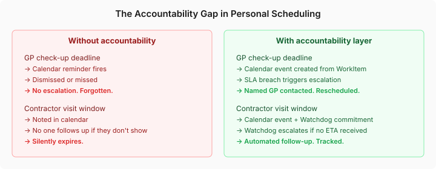
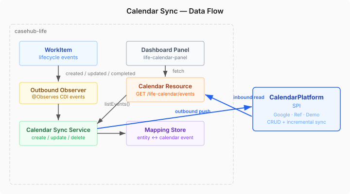

# Your Calendar Doesn't Care If You Miss a Deadline

Google Calendar is a scheduling tool. It puts events on a timeline and fires reminders. What it does not do — what no calendar tool does — is care about the outcome. A reminder fires, you dismiss it, and the calendar has done its job. Whether you actually went to the GP, whether the contractor showed up, whether the tax filing got submitted — that's on you.

This is the accountability gap in personal scheduling. And it is the exact gap that casehub-life's calendar integration was designed to close.

## The gap is structural, not accidental

A calendar entry is a note on a timeline. A WorkItem in casehub-life is a tracked obligation with an SLA, an escalation policy, and a commitment lifecycle. These are fundamentally different things — and until now, they lived in completely separate systems.

The problem shows up in practice:

- You create a WorkItem for a GP check-up with a two-week deadline. The SLA enforcement fires if the deadline passes. But that deadline never appears in your calendar, so your daily schedule has no awareness of it.
- A contractor commits to visiting between 2pm and 4pm on Thursday. CaseHub tracks the commitment with a Watchdog — but the visit window doesn't appear alongside your other Thursday appointments.
- A legal filing deadline exists as a WorkItem with an SLA breach policy. Your calendar shows the school run, the dentist, and a work meeting. The filing deadline is invisible until the escalation fires.

The scheduling and the accountability live in different worlds.



## What calendar sync actually means here

This is not a Google Calendar wrapper. The CalendarPlatform SPI already exists in casehub-connectors — full CRUD, incremental sync with tokens, a production Google Calendar implementation, and reference and demo implementations. Worker playbooks already call it: the appointment-prep worker reads calendar availability, the appointment-followup worker creates calendar events.

What was missing was the layer that connects life domain state to calendar state systematically. Not per-worker, per-playbook ad hoc calls — a reactive pipeline that keeps the calendar in sync with every WorkItem and case milestone across all eight life domains.

The architecture is straightforward:



A CDI observer watches `WorkItemLifecycleEvent`. When a WorkItem is created with a deadline, a calendar event appears. When the deadline is updated, the calendar event updates. When the WorkItem completes or is cancelled, the calendar event is removed. No case YAML changes needed — the observer is infrastructure, not a case step.

The mapping between CaseHub entities and calendar events is persisted through an SPI-backed store. This matters for two reasons: first, the service needs to know which calendar event corresponds to which WorkItem when an update or deletion happens. Second, the mapping enables the inbound enrichment — when the dashboard reads events from the calendar, it can distinguish CaseHub-managed events from external ones and enrich them with domain metadata.

## Why SPI, not JPA

A decision worth explaining: the mapping store is behind an SPI interface, not a direct JPA entity. casehub-life uses SPI-backed persistence throughout — `LedgerEntryRepository`, `CbrCaseMemoryStore`, `ActorTrustScoreRepository` all follow this pattern. The store could be backed by PostgreSQL, MongoDB, or anything else. The JPA implementation is one `@Alternative`; the in-memory implementation handles tests.

This might seem like boilerplate for a mapping table. It is. But platform consistency is not optional when you're building a system where components swap in and out — and where tests should never need a database to verify business logic.

## The dashboard as unified schedule

The other half of the integration is inbound: the life dashboard now shows all calendar events, not just CaseHub-managed ones. The mock calendar panel — hardcoded HTML with pretend events — is replaced by a Lit component that fetches from the new REST endpoint.

```java
@GET
@Path("/events")
public List<LifeCalendarEventResponse> listEvents(
        @QueryParam("from") String from,
        @QueryParam("to") String to) {
    Instant start = from != null ? Instant.parse(from) : Instant.now();
    Instant end = to != null ? Instant.parse(to) : start.plusSeconds(7 * 86400);
    return calendarSyncService.listEvents(start, end);
}
```

The response enriches each event with CaseHub metadata when a mapping exists — domain, entity type, entity ID, and a `casehubManaged` flag. The UI colour-codes events by domain (health is green, legal is red, contractor is amber) and marks CaseHub-managed events with an indicator. External events — the school run, the dentist, the work meeting — appear alongside them.

This is the point: your schedule is one thing. The platform adds accountability properties to the parts that need them, without pulling you out of a unified view.

## What this does not do yet

CaseHub is authoritative for events it creates. If you reschedule a WorkItem's calendar event directly in Google Calendar, CaseHub will not detect the change. The mapping table supports this follow-up — the event-to-entity link is persistent and queryable — but the reconciliation logic is a separate piece of work.

This is a deliberate scope boundary. Bidirectional conflict resolution is a genuinely hard problem (last-write-wins? manual merge? which system is source of truth for which fields?) and bolting it onto the initial integration would have delayed the core value: making tracked obligations visible in your daily schedule.

## The broader point

Most personal automation tools are fire-and-forget. Set a reminder, create a task, hope it works out. casehub-life is built on the opposite premise: personal obligations are structurally similar to business commitments, and they deserve the same accountability infrastructure — SLA enforcement, escalation policies, tamper-evident audit trails, commitment tracking.

Calendar sync is where that premise meets daily life. Your WorkItems with deadlines now appear in the place you actually plan your day. And when they expire, the platform does not shrug — it escalates.
