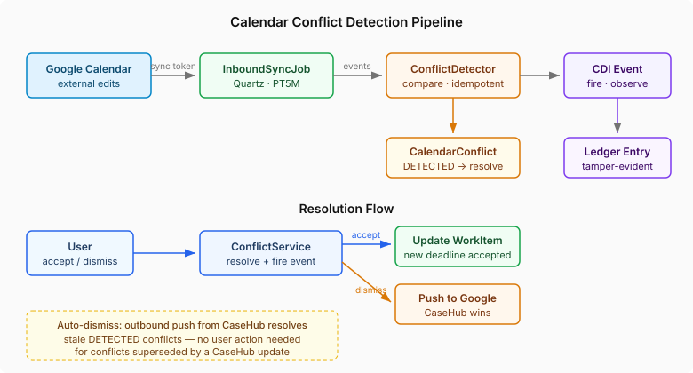

# External Edits Are Signals, Not Commands

The previous entry on calendar sync ended with a deliberate gap: "If you reschedule a WorkItem's calendar event directly in Google Calendar, CaseHub will not detect the change." That gap is now closed — and the design decision behind it turns out to be the most interesting part.

## The instinct that needs resisting

When you detect that someone edited your data in an external system, the natural instinct is to reconcile — pull the change in, update your records, keep everything in sync. Most integration patterns default to this. Last-write-wins. Auto-merge. Keep the systems consistent.

For a calendar app, that instinct is fine. For an accountability system, it is exactly wrong.

Consider: a GP appointment has a two-week SLA. The WorkItem deadline is 15 November. Someone opens Google Calendar and drags the event to 25 November. If CaseHub auto-reconciles, the SLA deadline silently shifts by ten days. No audit trail. No human decision. The accountability property that justified tracking the appointment in the first place — the deadline that triggers escalation if missed — just got undermined by a drag gesture in a scheduling UI.

The design principle that emerged: external edits are signals, not commands. CaseHub detects the change, surfaces it to the user, and waits. The human decides whether the external edit should change the tracked obligation.

## What the detection pipeline actually does

An incremental sync job runs every five minutes. Google Calendar's sync token API returns only events that changed since the last check — no full rescans, no polling every event. When the job finds a changed event, it compares the returned summary and timing against what CaseHub last pushed. If they differ, it is an external edit. If they match, it is CaseHub's own outbound push reflected back — an echo, not a conflict.

The comparison uses stored field values, not hashes. I considered hashing the pushed state into a single column — compact and simple. But calendar providers normalise data in transit: whitespace gets trimmed, timezones get canonicalised, durations get rounded. A hash computed before the push would not match a hash computed on the provider's normalised version, producing false positives on every sync cycle. Storing the actual pushed values and comparing field-by-field eliminates this class of false positive entirely.

Deletions get the same treatment. If a CaseHub-managed event disappears from Google Calendar — the sync API reports it in `deletedIds` — that surfaces as a conflict too. The user can accept the deletion (remove the calendar mapping, keep the WorkItem deadline) or dismiss it (recreate the event in Google). Neither option silently drops the tracking link.

## The idempotency question

Incremental sync can deliver the same change multiple times — token resets, pagination edge cases, provider retries. Without idempotency guards, each delivery creates a duplicate conflict. The detector checks for an existing unresolved conflict on the same mapping before creating a new one. If the external values match the existing conflict, it skips. If they differ — the user edited the event again before resolving the first conflict — it updates the existing conflict with the latest external state.

This matters more than it sounds. A user who reschedules a GP appointment three times in one afternoon should see one conflict with the latest state, not three stale conflicts they have to dismiss individually.

## Resolution as a first-class act

Accept and dismiss are not just UI buttons — they are distinct operations with different side effects.

Accept a modified conflict: the WorkItem deadline updates to match the external edit. The mapping's pushed state updates. The conflict is marked ACCEPTED. A tamper-evident ledger entry records the change, including the old and new values.

Dismiss a modified conflict: CaseHub pushes its state back to Google Calendar, overwriting the external edit. The conflict is marked DISMISSED. A ledger entry records that too.

Accept a deleted conflict: the mapping is removed (conflicts first, for FK safety). The WorkItem keeps its deadline — the calendar link is gone but the obligation remains.

Dismiss a deleted conflict: CaseHub recreates the event in Google. New event ID, same content. The mapping updates to point at the new event.

Every resolution fires a CDI event that the ledger observer catches. Every conflict — detection and resolution — ends up in the tamper-evident Merkle chain. When someone asks "did the GP appointment deadline change?" six months from now, the answer is in the ledger, with who changed it, when, and how.

## The auto-dismiss insight

One interaction pattern deserved special attention: what happens when CaseHub itself updates a calendar event while an unresolved conflict exists?

If a WorkItem deadline changes through CaseHub — an SLA extension, a manual update — the outbound push overwrites whatever is in Google Calendar. At that point, any existing DETECTED conflict is stale. The external edit that caused the conflict has been superseded by a CaseHub-authoritative update.

The outbound push now auto-dismisses stale conflicts. No user action required. The CDI event still fires, the ledger still records it, but the user does not see a conflict card for an edit that CaseHub already overwrote.

This also handles the FK constraint correctly. When a WorkItem completes and its calendar event is removed, the conflicts must be deleted before the mapping — otherwise the foreign key from `life_calendar_conflict.mapping_id` to `life_calendar_mapping.id` blocks the delete. Auto-dismiss resolves DETECTED conflicts first, then the cleanup deletes all conflict rows, then the mapping goes.

## Why this matters beyond calendars

The pattern here — detect external changes, surface them as conflicts, require explicit human resolution, audit every outcome — is not calendar-specific. It is the reconciliation pattern for any system where CaseHub integrates with an external tool that humans also edit directly.

Bank transactions that don't match expected contractor payments. IoT sensor readings that contradict a maintenance schedule. Insurance documents that arrive with different terms than what was quoted. Each of these is the same structural problem: an external system reports something that diverges from CaseHub's tracked state, and the divergence needs a human decision, not an automatic merge.

The calendar implementation is a worked example of a more general principle: accountability systems that auto-reconcile with external state are accountability systems that can be silently undermined. The human in the loop is not a UX inconvenience — it is the mechanism that makes the accountability property real. 
