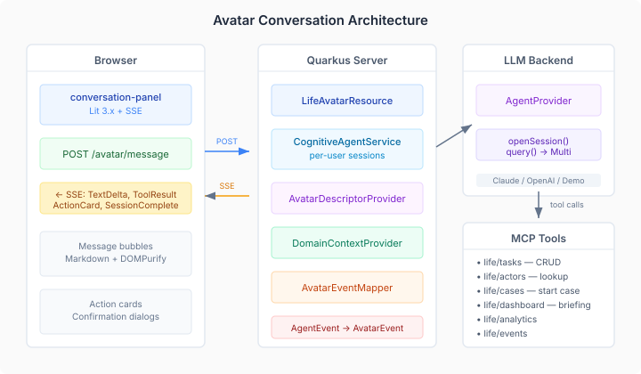
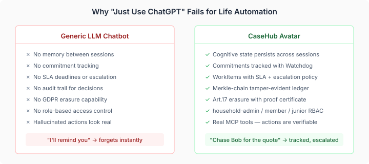

# The Avatar That Does Things

Personal life automation tools fall into two categories. The first is the forms-and-lists approach: create a task, set a deadline, check it off. Calendar apps, to-do lists, Notion boards. They work until you forget to check them, which is most of the time.

The second is the chatbot approach: talk to an AI, get advice, maybe it sets a reminder. ChatGPT, Siri, Google Assistant. They feel productive in the moment. Then the moment passes. The assistant forgot what you said. The reminder has no escalation policy. The "I'll follow up with the contractor" was a hallucination dressed as a commitment.

casehub-life just gained a third option — an avatar that actually does things, and proves it did them.

## What the avatar replaces

The right dock of the life-ui dashboard used to have a "Comms" panel — a static mock showing three hardcoded cards about school emails and contractor texts. Placeholder text with arrows pointing at extracted entities. "Coming soon."

It's no longer coming soon. The panel now contains a live conversation surface. Type a message, get a streamed response from an LLM that has access to your household's full state — active cases, pending tasks, overdue items, contractor commitments, calendar conflicts — and can act on it.

The architecture is deliberately simple. The user sends a POST request with plain text. The server opens (or reuses) a multi-turn LLM session for that user, injects the household's current state into the system prompt, and streams the response back as Server-Sent Events. The frontend parses the SSE stream and renders message bubbles with markdown support.

No WebSocket. No custom protocol. POST in, SSE out.

## Why POST+SSE and not WebSocket

The spec review caught this one before I did. The original design proposed a WebSocket conversation endpoint — bidirectional, full-duplex, the obvious choice for chat. Claude flagged the problem: casehub-life has zero WebSocket infrastructure. No `quarkus-websockets-next` dependency. No WebSocket auth model. No existing patterns to follow.

Meanwhile, the codebase already has a production SSE endpoint (`LifeEventSseResource`) streaming domain events to the dashboard. The pattern is proven: return a `Multi<T>` from a JAX-RS method with `@Produces(SERVER_SENT_EVENTS)`, and Quarkus handles the streaming. Why build new transport infrastructure when the existing one already works?

POST+SSE is also a better semantic fit. A conversation is request-response with a streaming response body — not a persistent bidirectional channel. The user sends a discrete message. The server streams a response. The connection closes. That's an HTTP POST with SSE, not a WebSocket.

## What makes this different from ChatGPT

The avatar has MCP tool access. When it says "I'll create a task for that," it means it. The platform's `@McpDomain` annotation generates dual MCP/REST endpoints from annotated service classes — six domains are already wired: tasks, actors, cases, dashboard, analytics, events. The avatar's LLM session is configured with these tools at session-open time. The LLM calls them during the conversation. The tool results stream back to the UI as structured events.

This is the gap that generic chatbots cannot close:

When the avatar creates a task, it becomes a WorkItem with an SLA deadline and an escalation policy. When it starts a contractor follow-up, that becomes a case with commitment tracking and a Watchdog that fires if the contractor doesn't respond. When it touches personal data, that goes through the GDPR-compliant Merkle-chain ledger. When it approves a financial decision, the approval is tamper-evident and attributable.

A generic chatbot can say "I'll remind you." The avatar creates a WorkItem with a breach policy that escalates to the admin channel if the deadline passes. Those are structurally different things.

## The cognitive stack — why it's not just a system prompt

The avatar's personality comes from the neocortex CognitionCore — a cognitive orchestrator that manages mood (PAD model), drives, user modelling, mental model (BDI extraction), strategy learning, narrative tracking, and goal proposals. This isn't prompt engineering. It's a graph of numeric states that evolve through interaction and get rendered into prompt sections that shape how the LLM responds.

The catch: CognitionCore's Maven artifacts aren't published yet. The neocortex extraction from blocks (the multi-agent orchestrator) is nearly complete but the last batch hasn't landed. So the current avatar ships as Phase A — the full conversation infrastructure with a static personality defined by an eidos AgentDescriptor. When the neocortex artifacts publish, CognitionCore plugs into the service with no architectural changes. The service already accepts it as an optional dependency.

I designed the split this way on purpose. The conversation surface, MCP tool access, SSE streaming, domain context injection, per-user session management — none of that depends on cognitive state. The avatar works without CognitionCore. It just doesn't evolve.

## The design review that changed the spec

I ran two rounds of adversarial design review on this spec — a light decision review (15 findings) and a standard spec review (16 findings across 3 rounds). Between them, they caught:

- **CognitionCore isn't on the classpath.** The spec originally said "we consume the existing API." It doesn't exist as a consumable artifact. The phased delivery split was a direct result of this finding.
- **`AgentSession.clear()` has a no-op default implementation.** The spec relied on it for mid-session context refresh. Claude caught that the interface's default is `void clear() {}` — calling it does nothing unless the backend overrides it. The fix: inject context updates as messages rather than relying on system prompt refresh.
- **The avatar bypasses the accountability infrastructure.** Engine workers go through risk classification, trust routing, CBR-informed decisions, and attestation pipelines. The avatar was designed as a standalone service that skips all of that. Valid concern, but deliberately chosen — the avatar is a user-facing conversation agent, not a case-execution worker. It starts cases and approves gates; it doesn't execute playbooks.
- **POST+SSE, not WebSocket.** Covered above. The review caught the transport design flaw before a single line of code was written.

Thirty-one findings across two reviews, and the spec was substantially different afterwards. The reviews took longer than I'd like — the reviewer agents were exploring CognitionCore's 200+ line class in a separate repo — but the findings were worth it.

## What the avatar opens up

The next two issues in the epic are intent resolution (#144) and avatar-driven UI (#145). Intent resolution adds the three-tier dispatch pipeline: the avatar classifies what the user wants, then routes to a direct MCP call, a parameterised playbook, or a full engine case depending on the action's accountability requirements. Avatar-driven UI transforms the dashboard from a static CRUD interface into a curated experience where the avatar decides what to show.

The interesting question is what happens when CognitionCore plugs in. The avatar currently has a static personality — helpful, proactive, warm. With CognitionCore, it will develop mood, track ongoing narratives ("the boiler saga"), build a model of each household member, and propose goals based on patterns it observes. The household assistant that remembers you hate dealing with insurance renewals, notices the renewal is coming up, and starts the comparison process before you ask.

That's the structural advantage of building on an accountability platform rather than wrapping a chatbot API. The avatar doesn't just talk about your life — it participates in it, with every action tracked, every commitment enforced, every decision auditable.
